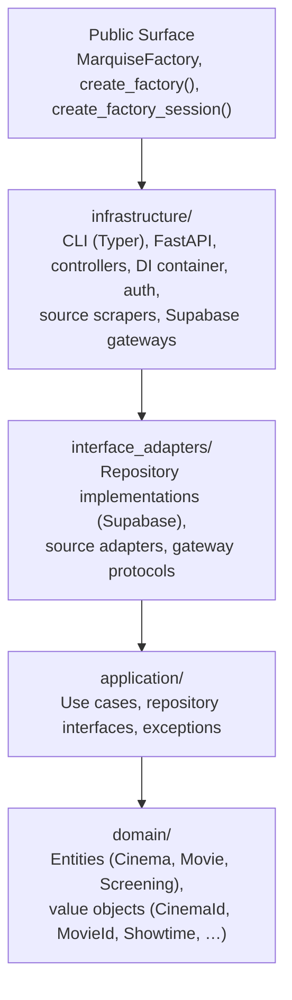
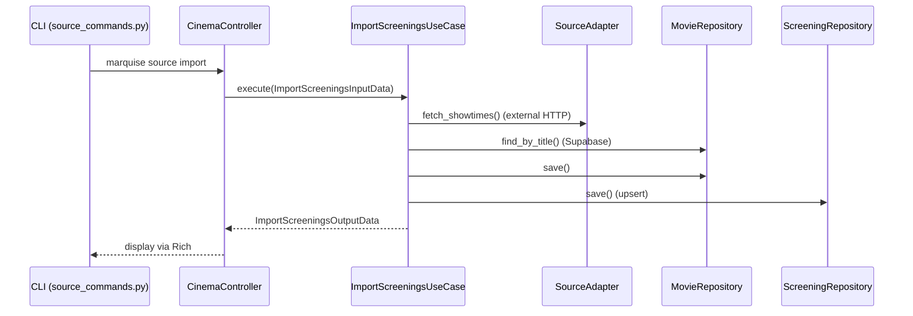

# Marquise Architecture

**Marquise** is a Montreal cinema showtimes aggregator. It fetches showtime data from multiple cinema sources (Cineplex, CinemaCinema, Cinema Public), normalises it, and stores it in a PostgreSQL database via Supabase.

## Tech Stack

| Component | Technology |
|---|---|
| Language | Python 3.13 |
| Package manager | uv |
| Database | Supabase (PostgreSQL via asyncpg) |
| CLI | Typer + Rich |
| REST API | FastAPI (read-only public endpoints + admin endpoints) |
| Testing | pytest + pytest-asyncio |
| Linting / formatting | Ruff |
| Coverage gate | 70% CI minimum (target: 80%+; 100% for domain/application) |

## Four-Layer Structure

Marquise follows **Clean Architecture**. Dependencies point **inward only** — outer layers depend on inner layers, never the reverse.



### Key directories

```
packages/marquise-core/src/marquise/
├── bootstrap.py           # Public API: MarquiseFactory, create_factory()
├── __init__.py            # Public surface re-exports (factory + controllers)
├── domain/
│   ├── entities/          # Cinema, Movie, Screening
│   └── value_objects/     # CinemaId, MovieId, ScreeningId, Showtime, SourceName
├── application/
│   ├── exceptions/        # ApplicationError hierarchy
│   ├── repositories/      # Abstract repository interfaces (ABCs)
│   └── use_cases/         # ImportScreeningsUseCase, CRUD use cases
├── interface_adapters/
│   └── repositories/
│       ├── protocols/     # Gateway protocols (typing.Protocol)
│       ├── supabase/      # Repository implementations (entity mapping)
│       └── source_adapters/  # Cineplex, CinemaCinema, CinemaPublic adapters
└── infrastructure/
    ├── cli/               # Typer app and command modules
    ├── api/               # FastAPI read-only REST API
    │   ├── routers/       # Endpoints (cinemas, movies, screenings)
    │   ├── schemas/       # Pydantic response models
    │   └── dependencies.py # Shared DI dependency
    ├── controllers/       # CinemaController, SourceController, AuthController
    ├── di/                # Dependency injection container
    ├── auth/              # Admin authentication
    ├── supabase/
    │   ├── config/        # Connection configuration
    │   └── gateways/      # Raw SQL operations (cinema, movie, screening, …)
    └── sources/
        ├── cineplex/      # Cineplex scraper (API + web)
        ├── cinemacinema/  # CinemaCinema scraper
        ├── cinemapublic/  # Cinema Public scraper
        ├── cinemamoderne/ # Cinéma Moderne scraper
        ├── cinematheque/  # Cinémathèque québécoise scraper
        └── outremont/     # Théâtre Outremont scraper
```

## Key Patterns

### Repository pattern

Abstract interfaces live in `application/repositories/` as ABCs. Concrete Supabase implementations live in `interface_adapters/repositories/supabase/` and translate between gateway dicts and domain entities.

### Gateway pattern

Raw SQL (asyncpg) is isolated in `infrastructure/supabase/gateways/`. Gateways implement the `typing.Protocol` types defined in `interface_adapters/repositories/protocols/`. Repositories in `interface_adapters/repositories/supabase/` call the gateway and convert the results to domain entities — no SQL leaks above this layer.

### Source adapter pattern

Each cinema source has a scraper under `infrastructure/sources/<source>/` and an adapter under `interface_adapters/repositories/source_adapters/`. Adapters translate raw `ShowtimeRow` dicts from scrapers into the format expected by use cases. The `source_registry.py` maps source names to adapter classes at runtime.

## Data Flow



## Public Surface & Import Boundary

Apps in `apps/` depend only on a defined public surface of `marquise-core` — never on internal modules.

### What is public

The public surface is defined by `marquise/__init__.py` and re-exported through `__all__`:

- `MarquiseFactory` — dependency container with lazy-loaded controllers
- `create_factory()` — async factory function that returns a configured `MarquiseFactory`
- `create_factory_session()` — async context manager for request-scoped sessions
- `CinemaController`, `SourceController`, `AuthController` — thin wiring layer

Domain entities, value objects, use cases, repositories, protocols, and infrastructure are **not** part of the public surface.

### Usage from apps

```python
from marquise import create_factory, create_factory_session

factory = await create_factory()

# Sync controller access
cinemas = await factory.cinema.find_all()

# Request-scoped session
async with create_factory_session() as session:
    await session.cinema.find_by_id(cinema_id)
```

### Import boundary rules

- `apps/` may import only from `marquise` (top-level) and `marquise.bootstrap`.
- `apps/` must **never** import from `marquise.{domain,application,interface_adapters,infrastructure}`.
- `packages/marquise-core/src/marquise/__init__.py` must not define classes or functions directly — only re-export from submodules.
- `__all__` must be tested against a frozen snapshot to prevent accidental additions.
- An AST-based scanner and `import-linter` contract verify these rules automatically.

## Planned Additions

- **Source adapters**: Additional scrapers (Cinema Moderne, Cinémathèque, Outremont, etc.).

## Further Reading

- Source architecture: [`docs/sources.md`](docs/sources.md)
- Known technical debt: [`docs/todo.md`](docs/todo.md)
- Development rules: [`AGENTS.md`](AGENTS.md)
- Setup and commands: [`CONTRIBUTING.md`](CONTRIBUTING.md)
