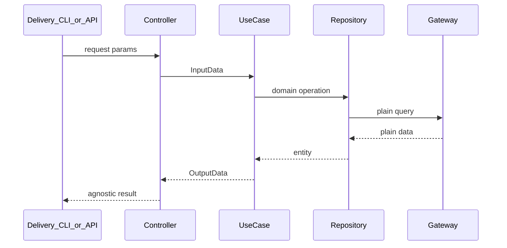

# Architecture

Design principles for this codebase. **Clean Architecture rules are mandatory** —
convenience, brevity, or lean shortcuts never justify breaking layer boundaries
or dependency direction.

| Document | Purpose |
|----------|---------|
| [AGENTS.md](../AGENTS.md) | Enforced rules and agent context |
| [CONTRIBUTING.md](../CONTRIBUTING.md) | This repository: paths, commands, CI |

---

## Dependency rule

Dependencies point **inward only**. Outer layers depend on inner layers; inner
layers never depend on outer layers.

```
┌──────────────────────────────────────┐
│  delivery  (CLI, API, UI apps)       │
├──────────────────────────────────────┤
│  infrastructure  (gateways, DI, I/O) │
├──────────────────────────────────────┤
│  interface_adapters  (repos, adapters)│
├──────────────────────────────────────┤
│  application  (use cases, repo ABCs) │
├──────────────────────────────────────┤
│  domain  (entities, value objects)   │
└──────────────────────────────────────┘
```

---

## Layer responsibilities

**Domain** — Entities, value objects, and domain rules. Standard library only.
No databases, HTTP, or framework imports.

**Application** — Use cases orchestrate business logic. Repository interfaces
(ABCs) and application exceptions live here. Imports domain only.

**Interface adapters** — Repository implementations map between domain entities
and external data shapes. External-source adapters normalise fetched rows.
Imports application and domain — never infrastructure.

**Infrastructure** — The only layer that executes SQL, network calls, and other
I/O directly. Gateways return plain data structures. DI wiring and controllers
live here. Controllers delegate to use cases — no business logic.

**Delivery** — CLI, API, and UI applications. Thin wiring only. Import the
published library facade — never internal library modules.

---

## Single responsibility

| Component | Owns | Must not |
|-----------|------|----------|
| Entity / value object | Invariants, domain logic | Persistence, HTTP, frameworks |
| Use case | Business orchestration | SQL, HTTP, UI concerns |
| Repository (adapter) | Entity ↔ store mapping | SQL, driver-specific types |
| Gateway | I/O with external systems; plain data out | Domain entities |
| Controller | Input DTO → use case → output DTO | Business logic, domain types in signature |
| Delivery entrypoint | Wire request to controller or factory | Business logic |

---

## Dependency injection and testability

Every collaborator a use case or adapter needs must be **passed in** (constructor
or factory) — never constructed internally, never read from globals.

- Use cases depend on **repository interfaces** (ABCs), not concrete stores
- Repository implementations depend on **gateway protocols**, not concrete drivers
- Controllers depend on **use cases**, not repositories directly
- A factory or container at the **composition root** wires concrete implementations

### Testability boundary

| Layer | Test type | External I/O |
|-------|-----------|--------------|
| Domain | Unit | None |
| Application | Unit | None — mock repository ABCs |
| Interface adapters | Unit | None — mock gateway protocols |
| Infrastructure (gateways, scrapers) | Integration | Real DB / network **only here** |
| Delivery apps | Unit | None — mock factory / controllers |

Everything **up to and including interface adapters** must be testable in
isolation with injected mocks — no database, no HTTP, no filesystem.

Infrastructure owns all side effects. If a test needs a real database or network,
it is an integration test and belongs with infrastructure tests.

---

## Boundaries (data and types)

- Application never imports infrastructure or delivery
- At the delivery edge, infrastructure exposes only use-case **input/output DTOs**
  — domain entities never appear in infrastructure or delivery signatures
- Repositories return domain types, not raw dicts
- Gateways return plain data (dicts, primitives), never domain entities
- Domain exceptions are caught in the application layer and re-raised as
  application errors — domain exceptions must not escape outward

---

## Key patterns

**Gateway → repository → use case** — I/O at the edge, entity mapping in the
middle, business logic at the center.

**External source adapter + registry** — Pluggable fetchers normalised to a
common row shape; registry selects implementation at runtime.

**Composition root / factory** — One place opens connections and injects
dependencies. No module-level mutable singletons.

---

## Data flow



---

## Public facade

Delivery applications depend on a **published library surface** only. Internal
layers are private. Import boundaries are enforced in CI — see
[CONTRIBUTING.md](../CONTRIBUTING.md).

### Frontend packages (same dependency idea)

In the web workspace, **apps depend on shared packages; packages never depend on
apps**. Shared packages expose an explicit public API (`exports`). UI components
receive data and callbacks via props — test with injected doubles, not live HTTP.
Dev-only preview pages stay out of publishable build output.

### Modular web packages

Same inject-at-the-boundary idea as [Dependency injection and testability](#dependency-injection-and-testability) on the backend: the app is the composition root; packages stay self-contained and testable without it.

| Package role | Owns | Must not | Tested with |
|--------------|------|----------|-------------|
| UI library | Components, hooks, pure filter logic | HTTP, routing, env, app-specific URLs | Vitest + mock client + Testing Library |
| Client package | Client protocol types, API data shapes, HTTP and mock implementations | App routing or env access | Vitest with injected `fetch` |
| App | Routes, layout, client configuration and prop wiring | Reimplementing UI logic or HTTP client | Integration/E2E optional; unit-test wiring with mocks |

**Composition rule:** apps **compose** library exports; they do not fork or duplicate library UI. All I/O crosses the client boundary — parallel to gateway protocols on the backend.

**Self-contained rule:** each package builds, lints, typechecks, and tests on its own; no implicit dependency on an app being present.

---

## Further reading

- [AGENTS.md](../AGENTS.md) — enforced rules, testing contract, violations checklist
- [CONTRIBUTING.md](../CONTRIBUTING.md) — workspace layout, commands, concrete test paths
