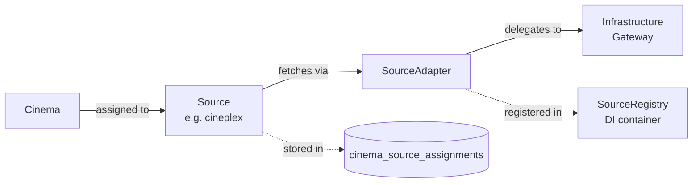
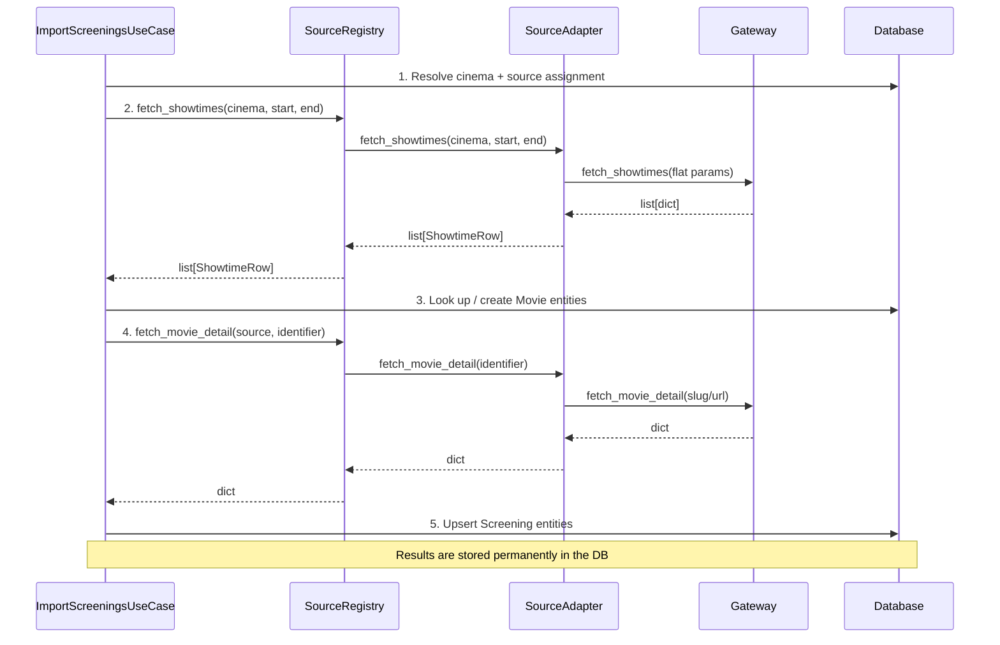

# Showtime Sources

## Overview

Marquise aggregates showtimes from many different cinemas. Each cinema gets
its showtime data from a different source — some scrape their website, some
call an API, some parse a PDF schedule.

A **Source** is the abstraction for "a way to get showtimes from a particular
cinema chain or independent cinema." Sources are **not baked into the code**
for each cinema. Instead, the mapping is dynamic:



Each source has two layers:

1. **Infrastructure gateway** (`packages/marquise-core/src/marquise/infrastructure/sources/<name>/gateways/source.py`):
   Raw scraper/API client. Accepts flat params (no domain entities). Returns
   plain dicts. Synchronous or async.

2. **Interface adapter** (`packages/marquise-core/src/marquise/interface_adapters/repositories/source_adapters/<name>.py`):
   Wraps a gateway. Translates `Cinema` domain entities into the flat params
   the gateway expects. Implements the `SourceAdapter` protocol.

This means:
- Adding a new cinema that already has a source is just assigning it in the DB
- Adding a new source is adding a gateway + adapter + 1 line in the container
- The `Cinema` entity has zero knowledge of sources

## Architecture

### Scraping / Import Pipeline



### API

FastAPI routes read showtimes from DB via repository queries. Never calls external sources directly. Caching via `fastapi-cache2` (configurable TTL). CORS via `MARQUISE_API_CORS_ORIGINS` env var.

## Domain Model

| Entity / VO | Where | Purpose |
|---|---|---|
| `SourceDefinition` | Domain | A source's identity: name, display name, description |
| `SourceName` | Domain | Value object wrapping a string (e.g. `"cineplex"`) |
| `CinemaSourceAssignment` | Domain | Links `Cinema` → `SourceDefinition` |
| `Movie` | Domain | Film with enriched metadata (poster, cast, genres, etc.) |
| `Screening` | Domain | A specific movie showtime at a cinema |
| `ShowtimeRow` | Application | Flat showtime row returned by sources (dataclass) |
| `MovieEnrichmentData` | Application | Optional enrichment metadata fetched from source |
| `RegistrySourceEntry` | Application | Source listing for the registry |

## Layer by layer

### Domain (`packages/marquise-core/src/marquise/domain/`)
- `value_objects/source_name.py` — wraps `str`
- `entities/source_definition.py` — the source catalog entry
- `entities/cinema_source_assignment.py` — maps cinema → source

### Application (`packages/marquise-core/src/marquise/application/`)
- `repositories/source_definition_repository.py` — ABC for source CRUD
- `repositories/cinema_source_assignment_repository.py` — ABC for assignments
- `repositories/source_registry_query.py` — `SourceRegistryQuery` ABC, `ShowtimeRow`, `MovieEnrichmentData`
- `use_cases/create_source.py` — register a new source
- `use_cases/list_sources.py` — list all sources
- `use_cases/delete_source.py` — remove a source
- `use_cases/assign_source.py` — link a cinema to a source
- `use_cases/unassign_source.py` — unlink a cinema
- `use_cases/get_cinema_source.py` — query assignment + source display name
- `use_cases/import_screenings.py` — fetch & persist showtimes + enrich movies

### Interface Adapters (`packages/marquise-core/src/marquise/interface_adapters/`)
- `repositories/protocols/showtime_source.py` — `ShowtimeSource(Protocol)` for scrapers
- `repositories/protocols/source_definition.py` — gateway protocol for source DB table
- `repositories/protocols/cinema_source_assignment.py` — gateway protocol for assignment DB table
- `repositories/source_adapters/base.py` — `SourceAdapter(Protocol)` with `fetch_showtimes` + `fetch_movie_detail`
- `repositories/source_adapters/cineplex.py` — maps cinema name → Cineplex location ID
- `repositories/source_adapters/cinemacinema.py` — maps cinema name → venue slug
- `repositories/source_adapters/cinemapublic.py` — maps cinema name → venue slug
- `repositories/source_registry.py` — maps source name → `SourceAdapter` instance
- `repositories/supabase/source_definition_repository.py` — adapts gateway → entities
- `repositories/supabase/cinema_source_assignment_repository.py` — adapts gateway → entities

### Infrastructure (`packages/marquise-core/src/marquise/infrastructure/`)
- `supabase/gateways/source_definition.py` — SQL CRUD for `source_definitions`
- `supabase/gateways/cinema_source_assignment.py` — SQL CRUD for `cinema_source_assignments`
- `supabase/gateways/movie.py` — SQL CRUD for `movies` (upsert on title conflict)
- `supabase/gateways/screening.py` — SQL CRUD for `screenings` (insert-or-noop)
- `sources/cineplex/gateways/source.py` — Cineplex API + HTML scraper
- `sources/cinemacinema/gateways/source.py` — CinemaCinema.ca SvelteKit scraper
- `sources/cinemapublic/gateways/source.py` — Cinema Public HTML scraper
- `controllers/source_controller.py` — validates admin, calls use cases
- `cli/source_commands.py` — CLI commands for admin
- `di/container.py` — wires all dependencies

## Implemented Sources

| Source | Gateway | Adapter | Enrichment |
|---|---|---|---|
| Cineplex | `sources/cineplex/` | `source_adapters/cineplex.py` | Yes |
| CinemaCinema | `sources/cinemacinema/` | `source_adapters/cinemacinema.py` | Yes |
| Cinema Public | `sources/cinemapublic/` | `source_adapters/cinemapublic.py` | Yes |
| Cinémathèque québécoise | `sources/cinematheque/` | `source_adapters/cinematheque.py` | Yes |
| Cinéma Moderne | `sources/cinemamoderne/` | `source_adapters/cinemamoderne.py` | Yes |

All five sources support movie enrichment via `fetch_movie_detail`, fetching poster
URLs, cast, directors, genres, description, and more from their detail pages.

### Cineplex

- **API**: `apis.cineplex.com/prod/cpx/theatrical/api/v1`
- **Detail pages**: `www.cineplex.com/movie/<slug>` (Next.js `__NEXT_DATA__`)
- **Auth**: API key via `Ocp-Apim-Subscription-Key` header (set `CINEPLEX_API_KEY` env var)
- **Location mapping**: Cinema name → numeric theatre ID (e.g., `"Cinéma Banque Scotia Montréal"` → `9406`)

### CinemaCinema

- **API**: `cinemacinema.ca/en/schedule/__data.json` (SvelteKit devalue format)
- **Detail pages**: `cinemacinema.ca/en/films/<slug>/__data.json`
- **Venues**: Beaubien, du Parc, du Musée

### Cinema Public

- **API**: `cinemapublic.ca/en/films/` (HTML scraping)
- **Detail pages**: Individual film pages (HTML + JSON-LD)
- **Venues**: Casa d'Italia, Livart

### Cinémathèque québécoise

- **API**: `cinematheque.qc.ca` ticketing portal (OmniWeb JS data blob)
- **Detail pages**: Re-fetches the showtime's date page (no standalone film detail page)
- **Discovery**: Bootstraps from today's page to discover the schedule window
- **Title cleaning**: Strips trailing parenthetical version markers (e.g. `(VOSTF)`) into the `language` field
- **Venues**: Cinémathèque québécoise

### Cinéma Moderne

- **API**: `/horaire/<year>/<month>` — server-rendered HTML calendar grid
- **Detail pages**: Film detail page with structured `<dl>` metadata block
- **Deduplication**: Fetches every month in the requested range concurrently, deduplicates by `(movie_url, showtime)`
- **External ID**: Derived from `EvenementID` + showtime (since `EvenementID` alone is shared across all showings of a film run)
- **Venues**: Cinéma Moderne

## Database Schema

The full schema lives in a single file, `scripts/marquise-schema.sql`, run
manually via the Supabase SQL Editor. Every statement uses `IF NOT EXISTS`,
so it's safe to re-run against an already-provisioned database.

```sql
CREATE TABLE marquise.cinemas (
    id      TEXT PRIMARY KEY,
    name    TEXT NOT NULL,
    address TEXT,
    city    TEXT,
    website TEXT
);

CREATE TABLE marquise.source_definitions (
    name                TEXT PRIMARY KEY,
    display_name        TEXT NOT NULL,
    description         TEXT
);

CREATE TABLE marquise.cinema_source_assignments (
    cinema_id   TEXT PRIMARY KEY
        REFERENCES marquise.cinemas(id) ON DELETE CASCADE,
    source_name TEXT NOT NULL
        REFERENCES marquise.source_definitions(name) ON DELETE CASCADE
);

CREATE TABLE marquise.movies (
    id               TEXT PRIMARY KEY,
    title            TEXT NOT NULL UNIQUE,
    release_year     INTEGER,
    directors        TEXT,
    cast_members     TEXT,
    duration_minutes INTEGER,
    description      TEXT,
    poster_url       TEXT,
    trailer_url      TEXT,
    genres           TEXT,
    original_title   TEXT,
    rating           TEXT,
    origin_countries TEXT
);

CREATE TABLE marquise.screenings (
    id          TEXT PRIMARY KEY,
    movie_id    TEXT NOT NULL
        REFERENCES marquise.movies(id) ON DELETE CASCADE,
    cinema_id   TEXT NOT NULL
        REFERENCES marquise.cinemas(id) ON DELETE CASCADE,
    showtime    TIMESTAMP NOT NULL,
    external_id TEXT UNIQUE,
    ticket_url  TEXT,
    room        TEXT,
    language    TEXT,
    UNIQUE (cinema_id, movie_id, showtime)
);

CREATE INDEX idx_screenings_movie_id ON marquise.screenings(movie_id);
CREATE INDEX idx_screenings_cinema_showtime ON marquise.screenings(cinema_id, showtime);
CREATE INDEX idx_screenings_movie_showtime ON marquise.screenings(movie_id, showtime);
```

## Movie Enrichment

When importing screenings, `ImportScreeningsUseCase` enriches movies with
metadata from the source (if the source supports it). The flow:

1. New movies (not found in DB) are created with just a title
2. Existing movies with any `None` enrichment fields are also candidates
3. The use case fetches metadata in parallel for all candidates via
   `SourceRegistry.fetch_movie_detail()`
4. Fields are populated selectively — only `None` fields get overwritten
5. Updated movies are saved back to the DB

The `MovieEnrichmentData` dataclass carries optional fields:
`description`, `directors`, `cast`, `duration_minutes`, `release_year`,
`poster_url`, `trailer_url`, `genres`, `original_title`, `rating`,
`origin_countries`.

## Configuration

| Env var | Required | Default | Purpose |
|---|---|---|---|
| `DATABASE_URL` | Yes | — | PostgreSQL connection string |
| `SUPABASE_URL` | Yes | — | Supabase project URL |
| `SUPABASE_PUBLISHABLE_KEY` | Yes | — | Supabase auth key |
| `CINEPLEX_API_KEY` | No | `""` | Cineplex API subscription key |
| `DATABASE_SCHEMA` | No | `marquise` | Database schema name |
| `MARQUISE_API_CACHE_TTL_SECONDS` | No | `3600` | Read-only API in-memory response cache TTL, in seconds |
| `MARQUISE_API_CORS_ORIGINS` | No | `""` | Comma-separated list of allowed CORS origins for the read-only API |

## CLI Usage

### Managing sources

```bash
# Register a new source
marquise source create \
  --name cineplex \
  --display-name "Cineplex" \
  --description "Cineplex Canada showtimes"

# List all registered sources
marquise source list

# Delete a source (interactive)
marquise source delete
```

### Assigning sources to cinemas

```bash
# Link a cinema to a source
marquise source assign \
  --cinema-id <cinema-uuid> \
  --source-name cineplex

# Remove the link
marquise source unassign \
  --cinema-id <cinema-uuid>

# Show what source a cinema is using
marquise source show \
  --cinema-id <cinema-uuid>
```

### Importing screenings

```bash
# Import one day of screenings for a cinema
marquise source import \
  --cinema-id <cinema-uuid> \
  --start-date 2026-06-22 \
  --end-date 2026-06-22
```

### Workflow example

```bash
# 1. Create the source
marquise source create --name cineplex --display-name "Cineplex"

# 2. Create a cinema
marquise cinema create --name "Cinéma Banque Scotia Montréal" ...
# → outputs ID: 550e8400-e29b-41d4-a716-446655440000

# 3. Assign the source to the cinema
marquise source assign \
  --cinema-id 550e8400-e29b-41d4-a716-446655440000 \
  --source-name cineplex

# 4. Import screenings
marquise source import \
  --cinema-id 550e8400-e29b-41d4-a716-446655440000 \
  --start-date 2026-06-22 \
  --end-date 2026-06-22

# 5. Verify
marquise source show \
  --cinema-id 550e8400-e29b-41d4-a716-446655440000
```

## Adding a New Source

### Step-by-step

1. **Create the gateway implementation**

   ```
   packages/marquise-core/src/marquise/infrastructure/sources/guzzo/gateways/source.py
   ```

   ```python
   """Guzzo cinemas showtime source."""

   from __future__ import annotations


   class GuzzoSource:  # structurally satisfies ShowtimeSource protocol
       """Showtime source for Guzzo Cinemas."""

       async def fetch_showtimes(
           self, venue_id: str, start_date: datetime, end_date: datetime,
       ) -> list[dict]:
           # Accepts flat parameters — no domain entities
           return [
               {
                   "movie_title": "Inception",
                   "showtime": "2026-06-22T19:30:00+00:00",
                   "identifier": "inception-slug",
               },
           ]

       async def fetch_movie_detail(self, slug: str) -> dict | None:
           """Fetch enriched metadata. Return None if unsupported."""
           return None
   ```

2. **Create the adapter**

   ```
   packages/marquise-core/src/marquise/interface_adapters/repositories/source_adapters/guzzo.py
   ```

   ```python
   """Adapter for Guzzo source."""

   from marquise.domain.entities import Cinema
   from marquise.interface_adapters.repositories.protocols.showtime_source import (
       ShowtimeSource,
   )


   class GuzzoAdapter:
       """Maps Cinema domain entity to flat GuzzoSource params."""

       def __init__(self, source: ShowtimeSource) -> None:
           self._source = source

       async def fetch_showtimes(
           self, cinema: Cinema, start_date: datetime, end_date: datetime,
       ) -> list[dict]:
           venue_id = _VENUE_MAPPINGS.get(cinema.name)
           return await self._source.fetch_showtimes(
               venue_id=venue_id, start_date=start_date, end_date=end_date,
           )

       async def fetch_movie_detail(self, identifier: str) -> dict | None:
           return await self._source.fetch_movie_detail(slug=identifier)


   _VENUE_MAPPINGS: dict[str, str] = {
       "Guzzo Complexe Desjardins": "desjardins",
   }
   ```

3. **Register in the DI container**

   In `packages/marquise-core/src/marquise/infrastructure/di/container.py`:

   ```python
   from marquise.infrastructure.sources.guzzo.gateways.source import GuzzoSource
   from marquise.interface_adapters.repositories.source_adapters.guzzo import (
       GuzzoAdapter,
   )

   # Inside _source_registry property:
   registry.register("guzzo", GuzzoAdapter(GuzzoSource()))
   ```

4. **Register in the database**

   ```bash
   marquise source create --name guzzo --display-name "Guzzo Cinemas"
   ```

5. **Assign to a cinema**

   ```bash
   marquise source assign --cinema-id <cinema-uuid> --source-name guzzo
   ```

### Conventions

- Use the same name string in the container `.register("xxx", ...)` as in
  `marquise source create --name xxx`
- Infrastructure gateways accept **flat parameters only** (no domain entities)
- Adapters translate `Cinema` domain entities → flat params
- Gateways return plain ``dict`` objects — never domain entities
- If enrichment is supported, implement `fetch_movie_detail` on the gateway
  and proxy it through the adapter; otherwise have it return `None`
